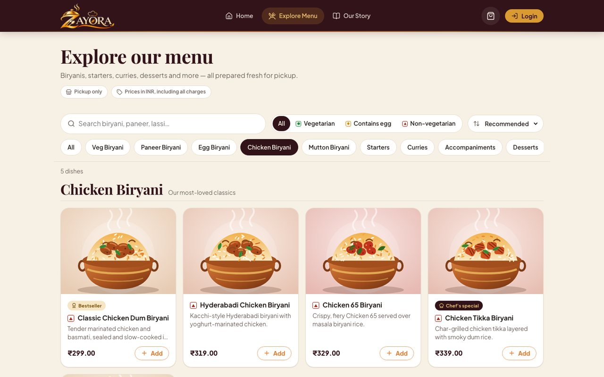
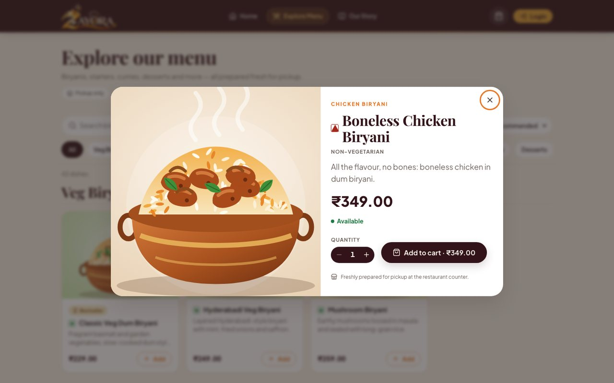

# FoodieHub

FoodieHub is a food-ordering platform built as a **learning and portfolio project**. It is a
hands-on way to practise microservice design, OAuth2/OIDC security, and Spec-Driven Development (SDD).

> **Status: working locally.** The customer web app is branded **ZAYORA** ("Where hunger meets flavours."), an
> Indian restaurant with biryani as its signature (DEC-014). Customers browse the 42-dish menu, sign in with Keycloak,
> check out a pickup order and follow it live; the restaurant owner manages the menu and moves orders through
> Accepted → Preparing → Ready → Picked up (DEC-015, DEC-016). It runs locally against MySQL. **No online payment**:
> an accepted order is paid at the counter. A platform **administrator** creates, edits, activates and deactivates
> restaurants, assigns owners and sees a platform overview (DEC-017). All API traffic goes through a Spring Cloud
> Gateway that finds the services in **Consul** and load-balances between their instances (DEC-019).

| Home | Menu | Dish detail |
|---|---|---|
|  |  |  |

### Demo in five minutes

Start everything as in the setup steps below (MySQL, Keycloak, both services with the `dev` profile, `npm run dev`).
Use two browser windows — a normal one and a private one — so the customer and the owner are signed in at the same time.
All demo passwords are `FOODIEHUB_DEMO_USER_PASSWORD` from `.env`.

1. **Customer** (`alice`): open http://localhost:5173, *Explore Our Menu*, filter **Vegetarian** or open a dish, add
   two dishes, open the cart, *Proceed to checkout* → log in → *Place pickup order*. The confirmation shows the
   server's prices and **Waiting for the restaurant**.
2. **Owner** (`owner`, private window): *Kitchen* → **Orders**. The new order is highlighted; click **Accept**.
3. **Customer**: within 20 seconds the tracker shows **Accepted** and "Pay at the counter when you collect".
4. **Owner**: *Start preparing* → *Mark ready* → *Picked up*. The customer's tracker follows each step with its time.
5. **Owner**, *Menu* tab: switch **Phirni** to available or change a price → the customer's menu shows it on reload.
6. Try the rules: the owner can't check out (customer accounts only); a second *Accept* on the same order is refused;
   *Reject* asks for an optional reason that the customer then sees.
7. **Admin** (dev admin from step 7a): *Admin* → Dashboard (counts, recent orders, activity) → *Restaurants* → ZAYORA →
   *Owner*: choose `owner` → **Change owner**. ⚠️ Do this once after upgrading to DEC-017: until then the owner's
   Kitchen is empty, because owner links made by username no longer grant access (they now use the account id).
   Then try *New restaurant* (it starts inactive and can't be activated without a dish) and *Deactivate* (asks first).

## Planned MVP scope

The planned MVP (see [`docs/sdd/plan.md`](docs/sdd/plan.md)) covers:

- Customers browse restaurants and menus and place an order from **one restaurant per order**.
- Fulfilment chosen per order: **pickup** or **delivery by the restaurant's own staff** (no delivery-partner system).
- **Simulated payments only** — no real payment provider is integrated.
- Restaurant owners manage their menu and move orders through preparation states.
- Admins create restaurants and assign owners.
- In-app notifications on order status changes.

Out of scope for the MVP: real payment gateway, multi-restaurant carts, delivery partners or tracking,
reviews, promotions, multiple currencies, partial refunds, mobile apps.

## Planned technology stack

Implemented so far: Java 21, Spring Boot 4.0.9 with Spring Cloud 2025.1.4 (restaurant service, order service, API
gateway), Spring Cloud Gateway (Server Web MVC), Consul service discovery with Spring Cloud LoadBalancer, MySQL,
Keycloak 26.8 (OIDC/JWT) and Docker Compose (optional: MySQL, Keycloak). Everything else is planned.

| Area | Planned technology |
|---|---|
| Frontend | React + Vite |
| Backend | Java 21, Spring Boot microservices: Restaurant, Order, Payment, Notification |
| API gateway | Spring Cloud Gateway |
| Identity and access | Keycloak (OIDC/JWT) with Spring Security |
| Database | MySQL (a single container, with a separate database and users per service) |
| Service discovery | Consul (implemented early, DEC-019; resilience still planned for M5) |
| Local infrastructure | Docker + Docker Compose |
| CI and code quality | Jenkins + SonarQube (planned; introduced at the end of M1) |

**Versions (DEC-019):** Spring Cloud has no GA release for Spring Boot 4.1 yet (2026.0 is a release candidate), so the
backend uses the supported pair Spring Boot 4.0.9 + Spring Cloud 2025.1.4. Moving to 4.1 / 2026.0 is a version bump
once that train is GA.

## Development status

| Item | Status |
|---|---|
| Current phase | **VS-1, CP-1 – CP-5** — browse, sign in, place a pickup order, view your own order (web app + backend) |
| Restaurant service | Implemented: list, detail and menu endpoints (menu items carry category, description, diet, bestseller / chef-special labels and an image key, DEC-014); owner endpoints (DEC-015, ownership by account id since DEC-017); administrator endpoints (DEC-017); Flyway schema V1–V4; ZAYORA seed (42 dishes); tests |
| Order service | Implemented: `POST /api/v1/orders` (server pricing, snapshots, one transaction, idempotent) `GET /api/v1/orders/{id}` (owner only) and `GET /api/v1/orders` (the customer's own orders, newest first, DEC-014); owner order list and lifecycle (DEC-015, DEC-016); read-only administrator overview (DEC-017); Flyway V1–V3; tests |
| Frontend | Implemented ([`frontend/`](frontend/)): ZAYORA web app — React + Vite + React Router; home, menu (categories, search, veg/egg/non-veg filter, price sort, dish detail), cart, protected checkout with a retry-safe `Idempotency-Key`, order confirmation, My Orders, owner Kitchen, admin pages (`/admin`); Keycloak sign-in (PKCE); 122 tests |
| API gateway and discovery | Implemented (DEC-019): `services/api-gateway` (port 8090) routes `/api/v1/**` to services registered in Consul (port 8500), checks tokens at the edge and balances requests over healthy instances |
| Payment / notification services | Not started |
| Build files | Maven Wrapper + root aggregator POM; Docker Compose for MySQL only. CI pipelines: not created |
| Security controls | Keycloak realm `foodiehub` with roles `CUSTOMER`, `RESTAURANT_OWNER` (DEC-015) and `ADMIN` (DEC-017); both services validate JWTs (issuer, signature, audience); only customers order; owners manage only their own restaurant (by account id); customers see only their own orders; admin endpoints need `ADMIN`; the application never grants roles (read-only Keycloak service account). Browsing stays public by design. **Not implemented:** gateway, authentication of the internal price lookup (SEC-005) |
| Payments | **Not available.** No payment processing of any kind exists |
| Documentation | SDD documents in [`docs/sdd/`](docs/sdd/) |

### Setup instructions (local development only)

The default setup uses a **MySQL Server installed directly on macOS**; Docker is not required to run the
restaurant service. An [optional Docker setup](#optional-docker-setup) is kept for CI and containerised use.

#### 1. Prerequisites

- **JDK 21.** Maven is not needed: use the Maven Wrapper (`./mvnw`).
- **Node.js** for the frontend (step 10): Node 22.12+ or 24 LTS recommended; Node 23.11 also works.
- **MySQL Community Server 8.4 LTS**, installed with either:
  - the macOS DMG from dev.mysql.com (choose the ARM64 or x86_64 build). The installer asks you to set a
    `root` password; the client is then at `/usr/local/mysql/bin/mysql`; or
  - Homebrew: `brew install mysql@8.4` (client: `/opt/homebrew/opt/mysql@8.4/bin/mysql`).
- Use a **MySQL 8.x client**. An older client on your `PATH` (for example a MySQL 5.7 client from
  Anaconda) cannot log in to MySQL 8.4 accounts that use the default `caching_sha2_password` plugin.

#### 2. Start MySQL locally

- DMG install: **System Settings → MySQL → Start MySQL Server**, or
  `sudo /usr/local/mysql/support-files/mysql.server start`.
- Homebrew: `brew services start mysql@8.4`.

Only one server can listen on port 3306. If the Docker MySQL container is running, stop it first with
`docker compose stop mysql` (this keeps its data). Check what is listening with `lsof -nP -iTCP:3306 -sTCP:LISTEN`.

The service connects over **TCP**, so MySQL must be started normally. If it was started for password
recovery (`mysqld_safe --skip-grant-tables --skip-networking`), it does not listen on any port: stop it with
`sudo /usr/local/mysql/support-files/mysql.server stop` and start it normally as above.

Verify connectivity (prompts for the password):

```bash
/usr/local/mysql/bin/mysql -u root -p -h 127.0.0.1 -P 3306 -e "SELECT VERSION(), @@port;"
```

#### 3. Configure `.env`

```bash
cp .env.example .env     # .env is git-ignored
```

Edit `.env` and replace both `CHANGE_ME` passwords (`RESTAURANT_DB_MIGRATOR_PASSWORD`,
`RESTAURANT_DB_APP_PASSWORD`). Choose your own values; don't use quotes, backslashes, `$` or spaces.
`MYSQL_ROOT_PASSWORD` is only used by the optional Docker setup.

| Variable | Used for | Default |
|---|---|---|
| `RESTAURANT_DB_URL` | JDBC URL (optional) | `jdbc:mysql://${MYSQL_HOST}:${MYSQL_PORT}/restaurant_db` |
| `MYSQL_HOST`, `MYSQL_PORT` | Server location | `localhost`, `3306` |
| `RESTAURANT_DB_APP_USER` / `RESTAURANT_DB_APP_PASSWORD` | Runtime connection (SELECT only) | `restaurant_app` / — |
| `RESTAURANT_DB_MIGRATOR_USER` / `RESTAURANT_DB_MIGRATOR_PASSWORD` | Flyway migrations | `restaurant_migrator` / — |

The service reads `.env` from its working directory or from the repository root. Real environment
variables override `.env`.

**Quick local option — use your local `root` account for both connections.** Set in `.env`:

```properties
RESTAURANT_DB_URL=jdbc:mysql://localhost:3306/restaurant_db
RESTAURANT_DB_APP_USER=root
RESTAURANT_DB_APP_PASSWORD=<your local root password>
RESTAURANT_DB_MIGRATOR_USER=root
RESTAURANT_DB_MIGRATOR_PASSWORD=<your local root password>
```

Then create the database once (Flyway creates the tables; this never touches existing data):

```bash
/usr/local/mysql/bin/mysql -u root -p -h 127.0.0.1 -P 3306 \
  -e "CREATE DATABASE IF NOT EXISTS restaurant_db CHARACTER SET utf8mb4 COLLATE utf8mb4_0900_ai_ci;"
```

and skip step 4. This is convenient but gives the running service full admin rights; step 4's dedicated
accounts (migrator for DDL, SELECT-only app user) are the safer setup.

#### 4. Create the database and users (once)

From the repository root:

```bash
infra/mysql/local/setup-local-db.sh
```

It reads the four database passwords from `.env` (`RESTAURANT_DB_*`, `ORDER_DB_*`), prompts for the MySQL `root`
password, and runs [`infra/mysql/local/restaurant-db-setup.sql`](infra/mysql/local/restaurant-db-setup.sql) and
[`infra/mysql/local/order-db-setup.sql`](infra/mysql/local/order-db-setup.sql) (`order_db`; `order_app` gets
`SELECT` and `INSERT` only). The script is
non-destructive and safe to re-run: it creates `restaurant_db` and the two accounts only if they don't
exist (for `localhost` and `127.0.0.1`), grants the migrator DDL/DML on `restaurant_db` only and the app
user `SELECT` only, and drops nothing. If your client isn't found automatically, set `MYSQL_BIN`, e.g.
`MYSQL_BIN=/opt/homebrew/opt/mysql@8.4/bin/mysql infra/mysql/local/setup-local-db.sh`.

Alternatively, in a `mysql -u root -p` session started from the repository root:

```sql
SET @migrator_password = '<your RESTAURANT_DB_MIGRATOR_PASSWORD>';
SET @app_password      = '<your RESTAURANT_DB_APP_PASSWORD>';
SOURCE infra/mysql/local/restaurant-db-setup.sql;
```

The tables are **not** created here: Flyway creates them when the service starts.

#### 5. Start the restaurant service

**Maven Wrapper:**

```bash
cd services/restaurant-service
../../mvnw spring-boot:run -Dspring-boot.run.profiles=dev     # http://localhost:8081
```

**IntelliJ IDEA:** open the repository root (`pom.xml`) as a project, set the project SDK to JDK 21, then
**Run → Edit Configurations… → + →**

- *Ultimate:* **Spring Boot** — Main class `com.foodiehub.restaurant.RestaurantServiceApplication`,
  module `restaurant-service`, **Active profiles** `dev`.
- *Community:* **Application** — same main class and module, **VM options** `-Dspring.profiles.active=dev`.
- **Working directory:** `$MODULE_WORKING_DIR$` (or the repository root; both find `.env`).
- No environment variables are needed when `.env` exists; you can set them in the run configuration instead.

On startup, Flyway (as `RESTAURANT_DB_MIGRATOR_USER`) creates the `restaurant` and `menu_item` tables and,
under the `dev` profile only, inserts the demo restaurant and menu. Restarting does not duplicate data: Flyway
reports "Schema `restaurant_db` is up to date" and the seed only re-runs (as an upsert) if its file changes.

Verify the database after the first start:

```bash
/usr/local/mysql/bin/mysql -u root -p -h 127.0.0.1 -P 3306 restaurant_db -e \
  "SHOW TABLES; SELECT version, description, success FROM flyway_schema_history; SELECT COUNT(*) FROM menu_item;"
```

Expected: tables `flyway_schema_history`, `menu_item`, `restaurant`; two successful migrations; 4 menu items.

#### 6. Test the API with Bruno or Postman

Create a collection with a variable `baseUrl = http://localhost:8081` and these `GET` requests (no auth):

| Request | Expected |
|---|---|
| `{{baseUrl}}/api/v1/restaurants` | `200`: `[{"id":"00000000-0000-0000-0000-000000000001","name":"FoodieHub Demo Kitchen"}]` |
| `{{baseUrl}}/api/v1/restaurants/00000000-0000-0000-0000-000000000001` | `200`: the restaurant |
| `{{baseUrl}}/api/v1/restaurants/00000000-0000-0000-0000-000000000001/menu` | `200`: `currency` `INR`, 4 items, prices like `129.50`; one item has `"available": false` |
| `{{baseUrl}}/api/v1/restaurants/unknown-id` | `404`, `application/problem+json` (identical for inactive restaurants) |

#### 7. Start Keycloak (sign-in, CP-2)

Keycloak runs as a normal Java program; no Docker is needed. Install it once:

```bash
mkdir -p ~/dev-tools && cd ~/dev-tools
curl -fLO https://github.com/keycloak/keycloak/releases/download/26.8.1/keycloak-26.8.1.tar.gz
echo "4e2740b181faa2ea623a1c2ecf00855935311e546046e2f857615a47ed24cbe8  keycloak-26.8.1.tar.gz" | shasum -a 256 -c -
tar xzf keycloak-26.8.1.tar.gz && rm keycloak-26.8.1.tar.gz
```

In `.env`, set `KEYCLOAK_HOME` (e.g. `/Users/<you>/dev-tools/keycloak-26.8.1`), `KEYCLOAK_ADMIN_PASSWORD` and
`FOODIEHUB_DEMO_USER_PASSWORD`. Then, from the repository root:

```bash
infra/keycloak/start-local-keycloak.sh    # keep this terminal open; Ctrl+C stops Keycloak
infra/keycloak/create-dev-users.sh        # in a second terminal (safe to re-run): roles CUSTOMER and RESTAURANT_OWNER,
                                          # users alice and bob (customers) and owner (manages ZAYORA)
```

- Keycloak listens on `http://localhost:8080` (bound to 127.0.0.1). Admin console: `http://localhost:8080/admin`
  (user `KEYCLOAK_ADMIN_USER`, password `KEYCLOAK_ADMIN_PASSWORD`; the admin is created on the first start only).
- On the first start the realm `foodiehub` is imported from [`infra/keycloak/foodiehub-realm.json`](infra/keycloak/foodiehub-realm.json)
  (no users or secrets in the file). It has two public clients:
  - `foodiehub-frontend`: for the future web app (authorization code + PKCE, `http://localhost:5173`);
  - `foodiehub-dev-cli`: **local testing only**, password grant for Bruno, Postman and curl.
- Tokens carry the audience `order-service`; the order service rejects tokens without it, tokens from other realms,
  and tokens with a bad signature or expired lifetime (15 minutes).

#### 7a. Administrator (DEC-017) — development only

The `ADMIN` role and a local administrator are created by one explicit script; demo users never get `ADMIN`.

1. Add these lines to your `.env` (see [`.env.example`](.env.example); choose your own values, never commit them):
   ```
   KEYCLOAK_ADMIN_API_CLIENT_SECRET=<a long random value, at least 24 characters>
   FOODIEHUB_DEV_ADMIN_USERNAME=admin.dev        # must not be alice, bob or owner
   FOODIEHUB_DEV_ADMIN_PASSWORD=<at least 8 characters>
   # optional, lets admins create owner accounts (DEC-018); a different long random value
   KEYCLOAK_OWNER_PROVISIONER_CLIENT_SECRET=<another value, at least 24 characters>
   ```
   One way to make a secret: `openssl rand -base64 32`.
2. With Keycloak running: `infra/keycloak/create-dev-admin.sh` (safe to re-run). It creates the realm role `ADMIN`, the
   confidential client `foodiehub-admin-api` with the secret from `.env`, gives that client's service account **read-only**
   access (`view-users`, `query-users`, `view-realm`: it can list and look up users, never change them or their roles),
   and creates the admin user with `ADMIN` only. With `KEYCLOAK_OWNER_PROVISIONER_CLIENT_SECRET` it also creates the
   group `restaurant-owners` and the client `foodiehub-owner-provisioner`, which has **no** realm-management roles and,
   through Keycloak's fine-grained admin permissions, may only create accounts inside that group (it cannot grant roles
   or touch any other account).
3. Restart the restaurant service so it reads the secrets (the read-only client lists owners, checks assignments and
   counts users; the provisioning client creates owner accounts; without a secret its features answer 503 and
   everything else works).
4. Log in as the admin user at http://localhost:5173 → **Admin**. Re-assign ZAYORA's owner once (Demo step 7).
5. **Onboard a new owner:** *Admin* → *Owners* → **Create owner** (full name, e-mail, username, temporary password;
   optionally pick a restaurant). Give the temporary password to the owner securely; at their first login Keycloak asks
   them to choose a new one, then the Kitchen shows the assigned restaurant. No restaurant chosen? Assign it later
   from the restaurant page.

**Production is different:** never run this script there. Create administrator accounts by hand in the Keycloak admin
console (with a strong password policy and MFA), create the `foodiehub-admin-api` client secret there, and give it to
the restaurant service through your secret store. For in-app owner creation, also create the group
`restaurant-owners` (role `RESTAURANT_OWNER`), the client `foodiehub-owner-provisioner` (service account, no
realm-management roles), enable *Admin permissions* in the realm settings and add a Groups permission for that client
on the group (view, view-members, manage-members, manage-membership); or leave the secret out and create owners in the
Keycloak console. Either way the application never grants roles.

#### 8. Start the order service (CP-3, CP-4)

The order service needs MySQL (`order_db`), Keycloak, Consul (step 8a) and the restaurant service (for prices) to be
running.
Create `order_db` once: `infra/mysql/local/setup-local-db.sh` does it (with dedicated `order_migrator` /
`order_app` accounts), or with the root option:
`/usr/local/mysql/bin/mysql -u root -p -h 127.0.0.1 -e "CREATE DATABASE IF NOT EXISTS order_db CHARACTER SET utf8mb4 COLLATE utf8mb4_0900_ai_ci;"`
(and set the `ORDER_DB_*` values in `.env` to match).

```bash
cd services/order-service
../../mvnw spring-boot:run -Dspring-boot.run.profiles=dev     # http://localhost:8082
```

IntelliJ: same as step 5, with main class `com.foodiehub.order.OrderServiceApplication`, module `order-service`,
active profile `dev`. Flyway creates `customer_order` and `order_item` on the first start.

| Port | Process |
|---|---|
| 3306 | MySQL |
| 8080 | Keycloak |
| 8081 | restaurant-service (a second instance can run on 8083, step 8a) |
| 8082 | order-service |
| 8090 | api-gateway (the only port the frontend talks to) |
| 8500 | Consul (UI: http://localhost:8500) |

#### 8a. Consul and the API gateway (DEC-019)

Since DEC-019 the services register in **Consul**, and the browser reaches them only through the **API gateway**.
Order of starting: MySQL → Keycloak → **Consul** → restaurant-service and order-service → **api-gateway** → web app.

```bash
brew tap hashicorp/tap && brew install hashicorp/tap/consul   # once
infra/consul/start-local-consul.sh                            # keep open; UI at http://localhost:8500
cd services/api-gateway && ../../mvnw spring-boot:run         # http://localhost:8090 (no dev profile needed)
```

- Start Consul **before** the services: they register on start-up and fail if Consul is unreachable. In the Consul UI
  each instance shows two green checks (the agent and `/actuator/health`).
- IntelliJ: add a run configuration for `com.foodiehub.gateway.ApiGatewayApplication` (module `api-gateway`).
- **Load balancing demo:** start a second restaurant-service with `--server.port=8083` (IntelliJ: copy the run
  configuration, add `--server.port=8083` as program argument, allow multiple instances; or
  `../../mvnw spring-boot:run -Dspring-boot.run.profiles=dev "-Dspring-boot.run.arguments=--server.port=8083"`).
  The gateway and order-service then alternate between both instances (see *Check load balancing* below).
- Routes: `/api/v1/orders/**`, `/api/v1/owner/orders/**`, `/api/v1/admin/orders/**` → `order-service`; everything else
  under `/api/v1/` → `restaurant-service`. Public browsing needs no token; all other API calls need a valid token at
  the gateway **and** pass the services' own role and ownership checks (plan.md D3). Only `/actuator/health` is open on
  each process; no other actuator endpoint is reachable.
- order-service calls restaurant-service as `http://restaurant-service` through the load balancer. To call one
  instance directly (without Consul), set `RESTAURANT_SERVICE_LOAD_BALANCED=false` and `RESTAURANT_SERVICE_URL`.
- Consul runs in development mode: in memory, no ACLs or TLS. Restarting it forgets registrations until each service
  restarts.

**Check discovery.** Every instance should be listed with passing checks:

```bash
curl -s http://localhost:8500/v1/health/service/restaurant-service | python3 -c \
  'import json,sys; [print(e["Service"]["Port"], [c["Status"] for c in e["Checks"]]) for e in json.load(sys.stdin)]'
# 8081 ['passing', 'passing']
# 8083 ['passing', 'passing']
```

**Check load balancing.** Requests through the gateway (or the web app's dev server) are spread round robin. One way to
see it: start the second instance with an access log, send requests, and count what it served:

```bash
# second instance, logging requests to /tmp/r2-access
../../mvnw spring-boot:run -Dspring-boot.run.profiles=dev \
  "-Dspring-boot.run.arguments=--server.port=8083 --server.tomcat.accesslog.enabled=true --server.tomcat.accesslog.directory=/tmp/r2-access"
# then, in another terminal: 20 requests through the gateway
for i in $(seq 20); do curl -s -o /dev/null http://localhost:8090/api/v1/restaurants; done
sleep 12; cat /tmp/r2-access/* | grep -c "GET /api/v1/restaurants "    # about 10: the other half went to 8081
```

**Failover demonstration.** Keep requesting while one instance stops:

```bash
for i in $(seq 60); do curl -s -o /dev/null -w "%{http_code} " http://localhost:8090/api/v1/restaurants; sleep 1; done
# meanwhile stop the 8083 instance (Ctrl+C in its terminal, or Stop in IntelliJ)
```

A clean shutdown deregisters the instance from Consul at once, so every request keeps answering `200` from 8081. After a
crash (no clean shutdown) Consul notices only through the failing health check (about 10 s) and the gateway refreshes
its cached instance list periodically, so some requests can fail for a short while. **No retries or circuit breakers
are configured yet** (Resilience4j is planned for M5); this setup is for local development, not production.

#### 9. Place and view an order (Bruno or Postman)

**Get a token.** In the request's **Auth** tab choose *OAuth 2.0*, grant type *Password Credentials*:

| Field | Value |
|---|---|
| Access Token URL | `http://localhost:8080/realms/foodiehub/protocol/openid-connect/token` |
| Client ID | `foodiehub-dev-cli` (no client secret) |
| Username / Password | `alice` (or `bob`) / your `FOODIEHUB_DEMO_USER_PASSWORD` |

**Place an order:** `POST http://localhost:8082/api/v1/orders` with headers `Content-Type: application/json` and
`Idempotency-Key: <a new UUID per order>` (Postman: `{{$guid}}`; Bruno: `{{$randomUUID}}`), body:

```json
{
  "restaurantId": "00000000-0000-0000-0000-000000000001",
  "fulfilmentType": "PICKUP",
  "items": [
    { "menuItemId": "00000000-0000-0000-0001-000000000001", "quantity": 2 },
    { "menuItemId": "00000000-0000-0000-0001-000000000003", "quantity": 1 }
  ]
}
```

Expected: `201 Created`, a `Location` header, status `PENDING_PAYMENT`, item names and prices from the menu, and
`total` = 458.00. Any price or total you put in the body is ignored. **No payment is taken**; the order is not yet
accepted by the restaurant.

**View it:** `GET http://localhost:8082/api/v1/orders/{id}` with the same token → `200`. With bob's token → `404`.

| Status | When |
|---|---|
| `201` | Order created, or the same request retried with the same `Idempotency-Key` (header `Idempotent-Replayed: true`, same order) |
| `400` | Malformed or invalid request: no items, more than 20 lines, quantity not a whole number from 1 to 50, missing or invalid `Idempotency-Key`, fulfilment other than `PICKUP` |
| `401` | No token, expired token, wrong realm or audience, bad signature |
| `404` | Order does not exist **or** belongs to someone else (identical responses) |
| `409` | `Idempotency-Key` already used by you for a different request |
| `422` | Restaurant not available, item not on its menu, item unavailable, item listed twice, amount too large (`code` field says which) |
| `503` | Restaurant service unreachable: no order is created; retry with the same key |

Idempotency rules (implementation choices; DEC-006's details are not owner-approved yet): keys are 8–64 characters
(letters, digits, `-`, `_`; a UUID is recommended), scoped to the signed-in user, and kept with the order.

**curl** (the token is kept in a shell variable, not printed):

```bash
TOKEN=$(curl -s http://localhost:8080/realms/foodiehub/protocol/openid-connect/token \
  -d grant_type=password -d client_id=foodiehub-dev-cli -d username=alice \
  --data-urlencode "password=$(read -rsp 'Password: ' p; echo "$p")" | python3 -c 'import json,sys; print(json.load(sys.stdin)["access_token"])')
curl -i http://localhost:8082/api/v1/orders -H "Authorization: Bearer $TOKEN" -H "Idempotency-Key: $(uuidgen)" \
  -H 'Content-Type: application/json' \
  -d '{"restaurantId":"00000000-0000-0000-0000-000000000001","fulfilmentType":"PICKUP","items":[{"menuItemId":"00000000-0000-0000-0001-000000000001","quantity":2}]}'
```

#### 10. Start the web app (CP-5)

Needs Keycloak (step 7), the restaurant service (step 5), the order service (step 8), Consul and the API gateway
(step 8a) running: the dev server sends all API calls to the gateway.

```bash
cd frontend
npm install        # first time only
npm run dev        # http://localhost:5173
```

Open **http://localhost:5173**. Pages: Home, Explore Menu (`/menu`), Our Story, Cart, Checkout, My Orders, order
details. Browsing is public; **Checkout** and **My Orders** ask you to log in (user `alice` or `bob`, password
`FOODIEHUB_DEMO_USER_PASSWORD` from `.env`) and bring you back afterwards, cart intact.

**Roles (DEC-015).** One login page for everyone; the Keycloak role decides what you see and may do:

| User | Role | Can |
|---|---|---|
| `alice`, `bob` | `CUSTOMER` | browse, order (only customers may order: Q-23), see their own orders |
| your dev admin (step 7a) | `ADMIN` | **Admin** (`/admin`): dashboard counts, restaurants (create, edit, activate / deactivate, assign owner), owner accounts (list, **create**), orders across restaurants (read-only). Cannot order or use the Kitchen. API: [`docs/sdd/api-admin.md`](docs/sdd/api-admin.md) |
| `owner` | `RESTAURANT_OWNER` | **Kitchen** dashboard (`/kitchen`): mark dishes available / sold out, edit price, description and labels; **manage orders**: accept or reject (optional reason), start preparing, mark ready, picked up; Active and History lists (refresh every 20 s). Cannot order (403). |

The owner is linked to ZAYORA in `restaurant_db.restaurant_owner` (dev seed). Owner API: `GET /api/v1/owner/restaurants`,
`GET /api/v1/owner/restaurants/{id}/menu`, `PATCH /api/v1/owner/restaurants/{id}/menu-items/{itemId}` (Restaurant Service,
token audience `restaurant-service`) and `GET /api/v1/owner/orders` (Order Service). Not built yet: order status
changes beyond the flow below, adding or removing dishes. Since DEC-017 an owner is identified by account id (`sub`):
an administrator assigns owners (`/admin`); the seeded username link grants nothing until re-assigned.

**Order lifecycle (DEC-016):** `PENDING_PAYMENT → ACCEPTED | REJECTED`, then `PREPARING → READY_FOR_PICKUP →
PICKED_UP`. An accepted order is **paid at the counter** (no online payment). Owners change status with
`PATCH /api/v1/owner/orders/{id}/status` and a body `{"from":"<status on screen>","status":"<next>","reason":"SOLD_OUT|TOO_BUSY|CLOSING"}`
(reason only when rejecting). A skipped step or a stale screen (`from` no longer current) gets **409**; every change
is recorded in `order_db.order_status_change`. Customers see the progress tracker on the order page and status in
My Orders, refreshed every 20 s while the order is in progress.

- Port **5173 is required**: Keycloak only accepts sign-in redirects to `http://localhost:5173`.
- The dev server forwards every `/api` call to the API gateway on port 8090 (`vite.config.ts`; override with
  `GATEWAY_URL`), which routes it to the right service through Consul. The browser never calls the services directly.
- Optional browser settings are in [`frontend/.env.example`](frontend/.env.example): service base URLs
  (`VITE_RESTAURANT_API_URL`, `VITE_ORDER_API_URL`; direct URLs need CORS on the services), `VITE_RESTAURANT_ID`, and
  Keycloak (`VITE_KEYCLOAK_URL`, `VITE_KEYCLOAK_REALM`, `VITE_KEYCLOAK_CLIENT_ID`). No secrets: the client is public.
- Tokens stay in memory and are refreshed automatically; an expired session shows a "log in again" prompt. The cart
  is kept in `localStorage` (survives refreshes and the sign-in redirect) and is re-checked against the live menu:
  sold-out dishes block checkout and display prices are refreshed. No prices are sent with an order.
- **Images:** drop photos into `frontend/src/assets/{hero,dishes,categories}` using the names in
  [`frontend/src/assets/README.md`](frontend/src/assets/README.md); they are picked up automatically, otherwise
  placeholder artwork is shown. The current hero image is a temporary crop.
- **Texts and messages:** all UI text and error messages are in
  [`frontend/src/messages/en.json`](frontend/src/messages/en.json); colours and fonts are tokens in
  `frontend/src/styles/tokens.css`. Backend error and validation texts are in each service's
  `src/main/resources/messages.properties` (API responses carry a stable `code`; the frontend shows its own text).
- The home page "What guests say" section is **sample content**, labelled as such; reviews are not collected.
- Commands: `npm test` (logic and component tests: Node's built-in runner with `tsx`, components rendered with
  `react-dom/server`), `npm run typecheck`, `npm run build`.

#### Troubleshooting

- **`Access denied for user 'restaurant_migrator'` (using password: YES)**:
  - the passwords in `.env` don't match the accounts in the MySQL server you are connected to (check the
    port 3306 owner, above); or
  - `.env` wasn't found, in which case Spring passes the literal `${...}` text as the password. Check the
    working directory.

  `CREATE USER IF NOT EXISTS` never changes an existing password. To align an existing account with `.env`,
  run as root, for each host (`localhost` and `127.0.0.1`):
  `ALTER USER 'restaurant_migrator'@'localhost' IDENTIFIED BY '<new password>';`
  (and likewise for `restaurant_app`).
- **`Public Key Retrieval is not allowed`**: the account was created but never logged in with a password
  over TLS. Log in once with the MySQL 8.4 client (`mysql -u restaurant_migrator -p -h 127.0.0.1`), or add
  `?allowPublicKeyRetrieval=true` to `RESTAURANT_DB_URL` for local development only.

#### Running the tests

From the repository root: `./mvnw verify` (both services). Unit and controller tests always run. The MySQL
integration tests use Testcontainers and are **skipped** when Docker is not running; they never use your local
MySQL. The order-service integration tests cover authentication, validation and bounds, server-side pricing,
snapshots, single-transaction storage, idempotency (including concurrent retries) and ownership; they use
simulated tokens and a mocked restaurant service. `JwtValidationTest` (no Docker needed) sends real signed tokens
through the service's token checks and expects `401` for a forged signature, a modified payload, an expired token,
the wrong issuer, a wrong or missing audience, an unsigned token and a malformed token. Tokens from the running
Keycloak are checked manually with steps 7–9.

Frontend: `cd frontend && npm test` runs 136 tests: cart limits, totals and live-menu checks; menu search, category
and diet filters and sorting; retry-safe idempotency keys; the API client (tokens, base URLs, Problem Details, expired
sessions, admin calls); messages; admin form checks and dashboard figures; and rendered components (navbar, dish
card, menu, protected routes including `/admin`, cart and checkout, order confirmation, kitchen, admin tables and
cards, error messages). Components are rendered to static HTML, so clicks and data loading in the browser are checked
manually. Clicking through in a real browser is manual (step 10); browser end-to-end tests
(Playwright) are planned for M5.

#### Optional Docker setup

[`compose.yaml`](compose.yaml) starts MySQL 8.4 in a container on `127.0.0.1:3306` and creates
`restaurant_db`, `order_db` and their default accounts from `.env` (including `MYSQL_ROOT_PASSWORD`) via
[`infra/mysql/init/`](infra/mysql/init/). Use it **instead of** a local MySQL, not alongside it on the same port.

```bash
docker compose up -d mysql      # then start the service exactly as in step 5
docker compose stop mysql       # stop, keeping data
docker compose --profile keycloak up -d keycloak   # optional: Keycloak in a container instead of step 7
```

The container creates its accounts only when its data volume is first initialised; passwords changed in
`.env` afterwards are not applied. Either use `ALTER USER` inside the container, or reset it with
`docker compose down -v` (this **deletes** the container's database). If `docker` is not found after
installing Docker Desktop, add `~/.docker/bin` to your `PATH`.

## Milestones (planned)

| Milestone | Planned focus |
|---|---|
| M0 | Repository foundation, toolchain, SDD documents |
| M1 | Public browsing of restaurants and menus (frontend → gateway → restaurant service) |
| CI-1 | Jenkins + SonarQube against the M1 code (end of M1) |
| M2 | Authenticated checkout with Keycloak; order service |
| M3 | Simulated payments, order expiry and refunds |
| M4 | Restaurant-owner workflow, admin functions, notifications |
| M5 | Hardening: Consul discovery (done early, DEC-019), resilience, container images, end-to-end tests |

Milestone scope is still subject to approval and may change; [`docs/sdd/plan.md`](docs/sdd/plan.md) is the source of truth.

## Documentation

Project documentation follows Spec-Driven Development and lives in [`docs/sdd/`](docs/sdd/).
Currently available:

- [`docs/sdd/plan.md`](docs/sdd/plan.md) — the overall plan, approval checklist, architecture and milestones.
- [`docs/sdd/raw-requirement.md`](docs/sdd/raw-requirement.md) — reconstructed owner requirements.
- [`docs/sdd/clarification.md`](docs/sdd/clarification.md) — open questions and recorded owner decisions (DEC-001 – DEC-017).
- [`docs/sdd/api-admin.md`](docs/sdd/api-admin.md) — administrator API (DEC-017).
- [`docs/sdd/spec.md`](docs/sdd/spec.md) — VS-1 specification (draft).
- [`docs/sdd/data-model.md`](docs/sdd/data-model.md) — logical data model (draft).

Other API contracts, ADRs, tasks, test strategy and DevOps documents do not exist yet.
