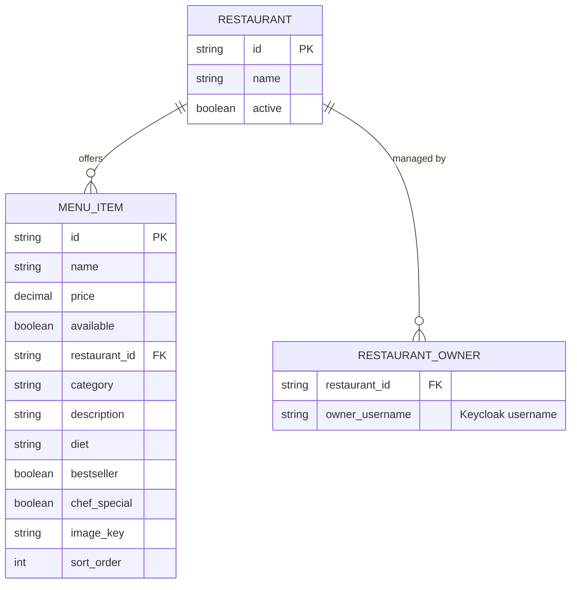
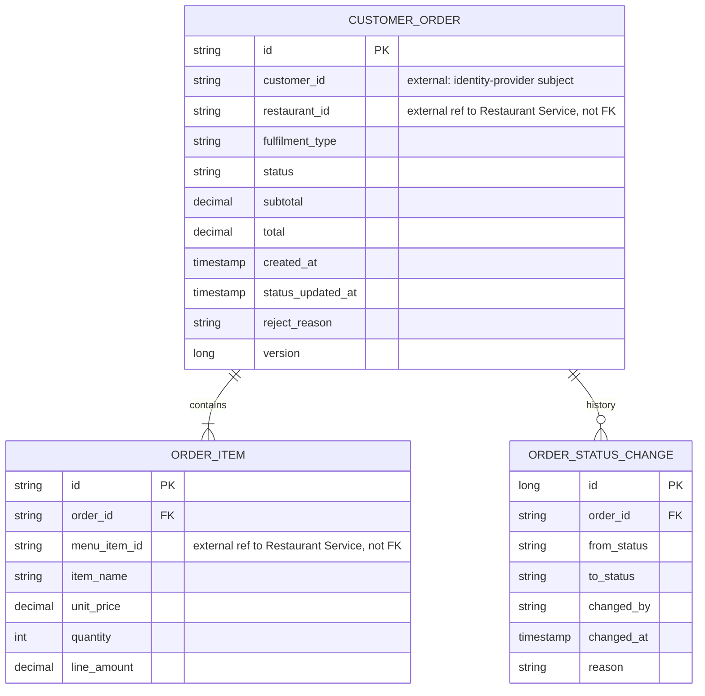

# FoodieHub — Data Model

**Status:** DRAFT  
**Scope:** VS-1 (Vertical Slice 1) and the increment after it (DEC-014 – DEC-016)  
**Decision baseline:** DEC-001–DEC-016 (DEC-013 – DEC-016 applied 2026-11-06)  
**Purpose:** Describe the logical data model and proposed persistence structure for FoodieHub.

---

## 1. Purpose and scope

This document describes the proposed data model for FoodieHub's VS-1 implementation.

VS-1 supports (scope accepted by DEC-003; durable persistence in CP-3 and retrieval with ownership checks in CP-4 per DEC-005):

- Public browsing of one seeded active restaurant and its menu.
- Authenticated pickup checkout.
- Server-side order validation and pricing.
- Durable order persistence.
- Order confirmation and retrieval.

The increment after VS-1 adds (owner-decided, `clarification.md` §9.2):

- Menu item details: category, description, diet, labels, image key, position (DEC-014).
- The customer's own order list (DEC-014).
- Restaurant owners linked to their restaurants, with menu edits and an owner order view (DEC-015).
- The pickup order lifecycle with a status history (DEC-016).

The implemented schema is `restaurant_db` V1–V3 and `order_db` V1–V2 (Flyway migrations in each service).

The model distinguishes owner-approved decisions from proposed implementation details and unresolved decisions.

Basis labels used in this document:
- **Owner-decided:** recorded in `clarification.md` §9.2 and cited as DEC-xxx.
- **Spec requirement:** a `spec.md` FR/BR/SEC item, which carries its own basis there (for example CONFIRMED or PROPOSED [PENDING Q-xx]).
- **Proposed:** a design proposal in this document; not owner-approved.
- **Not finalized / open:** an unresolved decision (Q-xx, OPEN-xx).

This document does not approve outstanding specification questions or expand VS-1 scope.

## 2. Modeling principles

1. Monetary values use exact decimal representations (DEC-007; BR-012).
2. Binary floating-point arithmetic must not be used for monetary calculations (DEC-007; BR-012).
3. Menu prices use `DECIMAL(10,2)` as finalized by DEC-012.
4. Order monetary fields and their precision, scale, and rounding remain unresolved (Q-14; D6 recorded but unverified; DEC-012 excludes them).
5. Order creation must result in durable persistence before success is reported (DEC-005; FR-031).
6. Order creation must support idempotency (DEC-006); its complete persistence and recovery design remains subject to the outstanding decisions.
7. Authentication is provided through Keycloak (D10 owner selection: Keycloak in M2, which contains CP-2 per DEC-002; security-design topics confirmed by TC-11; flow details PROPOSED in `plan.md` §6 — `spec.md` FR-010).
8. Public browsing must not expose inactive restaurants (DEC-009; DEC-010; SEC-008).
9. Only the orderer should be permitted to retrieve their order, subject to the pending ownership decision Q-24 (SEC-003, FR-040: PROPOSED).
10. Each service owns its own data (logical ownership): Restaurant Service owns `Restaurant` and `MenuItem`; Order Service owns `Order` and `OrderItem`. References from Order Service data to Restaurant Service data are **external identifiers**, never database-enforced foreign keys, and Order Service never reads or joins Restaurant Service tables (§6). Basis: D11 (owner selection: one MySQL instance with a separate database per service); the assignment of tables to services is the proposal in §6.1–§6.2, and the no-join rule is a design principle of this document, not a recorded owner decision.

## 3. Logical entities

### 3.1 Restaurant

Represents a restaurant available for browsing and ordering.

| Attribute | Type | Description |
|---|---|---|
| id | Identifier | Restaurant identifier |
| name | String | Restaurant display name |
| active | Boolean | Internal restaurant activity flag |

**Owner-decided:**
- Restaurant attributes include `id`, `name`, and `active` (DEC-008). Public display of `active` is superseded by DEC-009: the flag is not displayed (§8).
- VS-1 uses exactly one seeded restaurant (DEC-003).
- Public browsing includes active restaurants only (DEC-009).
- Inactive restaurants are omitted from public listings (DEC-009).
- Public restaurant detail and menu requests for inactive restaurants return 404, indistinguishable by response status and body from nonexistent restaurants (DEC-010; SEC-008).

**Proposed constraints:**
- `id` is the primary key.
- `name` is required.
- `active` is required.

Restaurant ownership, administration, and restaurant-management functionality are outside the VS-1 data model scope.

### 3.2 MenuItem

Represents an item belonging to one restaurant.

| Attribute | Type | Description |
|---|---|---|
| id | Identifier | Menu item identifier |
| name | String | Item name |
| price | DECIMAL(10,2) | Menu price in INR |
| available | Boolean | Whether the item is currently available |
| restaurant_id | Identifier | Owning restaurant |
| category | String (code) | Menu section, e.g. `CHICKEN_BIRYANI`; default `OTHER` (DEC-014) |
| description | String (≤ 300), optional | One-line description (DEC-014) |
| diet | `VEG` / `EGG` / `NON_VEG`, optional | Diet mark; null = not specified (DEC-014) |
| bestseller | Boolean | Label chosen by the restaurant, not computed from sales (DEC-014) |
| chef_special | Boolean | Label chosen by the restaurant (DEC-014) |
| image_key | String, optional | Name of the dish photo used by the frontend (DEC-014) |
| sort_order | Integer | Position within the menu (DEC-014) |

**Owner-decided:**
- Menu item attributes are `id`, `name`, `price`, `available`, and `restaurantId` (DEC-007).
- An item belongs to one restaurant (DEC-007).
- A restaurant may have multiple menu items (DEC-007).
- Menu prices use `DECIMAL(10,2)` as the final representation (DEC-012).
- Menu prices are in INR (DEC-007; BR-011).
- Unavailable menu items remain visible and marked (DEC-008; DEC-009).
- The server validates item availability during checkout (DEC-008; BR-004).
- The menu carries category, description, diet, bestseller / chef-special labels and an image key (DEC-014); the
  ZAYORA seed of 42 dishes and its prices (DEC-014).
- The restaurant's owner may change `available`, `price`, `description`, `bestseller` and `chef_special` of their own
  restaurant's dishes (DEC-015). Adding or removing dishes is not decided.

**Proposed constraints:**
- `id` is the primary key.
- `restaurant_id` is a foreign key to `Restaurant.id` (both tables are owned by Restaurant Service).
- `name`, `price`, `available`, and `restaurant_id` are required.
- `price` must not be negative.
- Maximum representable menu price: ₹99,999,999.99 (follows from `DECIMAL(10,2)`, DEC-012).
- Naming: `restaurant_id` is the proposed persistence name for DEC-007's `restaurantId`; API field naming is not set here.

The behavior of adding unavailable items to the client cart remains unresolved. DEC-008 contains the sentence "Users cannot add unavailable items to the cart.", but `spec.md` §14.1 flags it and does not adopt it as an approved requirement; the owner needs to confirm its status. The server-side availability check (BR-004) does not depend on it.

### 3.3 Order

Represents a customer's submitted pickup order.

| Attribute | Proposed logical type | Description |
|---|---|---|
| id | Identifier | Order identifier |
| customer_id | String | Authenticated customer's stable identity |
| restaurant_id | Identifier | **External reference** to the restaurant, which Restaurant Service owns; not a database foreign key |
| fulfilment_type | String / enum | Pickup for VS-1 |
| status | String / enum | `PENDING_PAYMENT` (initial), `ACCEPTED`, `REJECTED`, `PREPARING`, `READY_FOR_PICKUP`, `PICKED_UP` (DEC-011, DEC-016) |
| currency | String | `INR` |
| subtotal | DECIMAL(10,2) | Order subtotal, INR (DEC-013) |
| total | DECIMAL(10,2) | Order total = subtotal, no tax or fees (DEC-013) |
| created_at | Timestamp | Order creation timestamp |
| idempotency_key, request_hash | String | Idempotent creation, unique per customer and key (DEC-006; details are an implementation proposal) |
| status_updated_at | Timestamp, optional | When the status last changed (DEC-016) |
| reject_reason | `SOLD_OUT` / `TOO_BUSY` / `CLOSING`, optional | Only for `REJECTED` (DEC-016; the list is a proposal) |
| version | Integer | Optimistic locking for status changes (proposal) |

**Owner-decided:**
- Order creation requires authentication (DEC-003 for VS-1; DEC-009 for the MVP demo; RR-007; FR-011).
- VS-1 supports pickup only (DEC-003).
- The order is durably persisted before success is reported (DEC-005).
- The initial order status is `PENDING_PAYMENT` (DEC-011).
- The confirmation means the order was received and created (DEC-011).
- Confirmation does not imply payment success or restaurant acceptance (DEC-011; DEC-003).
- Order amounts are `DECIMAL(10,2)` in INR; line = price × quantity; total = sum of lines; no tax or fees (DEC-013).
- Only the orderer can read an order; anyone else gets 404 (DEC-013, Q-24). The orderer can list their own orders (DEC-014).
- Unpaid orders stay `PENDING_PAYMENT` with no automatic expiry; several are allowed per customer (DEC-013).
- Lifecycle `PENDING_PAYMENT → ACCEPTED | REJECTED`, `ACCEPTED → PREPARING → READY_FOR_PICKUP → PICKED_UP`;
  an accepted order is paid at the counter; only the owner of the order's restaurant changes the status (DEC-016).
- Only users with the `CUSTOMER` role may create orders (DEC-015, Q-23).

**Proposed:**
- Generate a unique order identifier.
- Associate the order with the authenticated customer's stable subject identifier from the identity provider (FR-032; Q-25 recommended default: token `sub` — implemented).
- Store the restaurant reference as an external identifier (no cross-service foreign key).
- Store the order's monetary summary.

**Not finalized:**
- Rounding rules: none approved; none needed for the approved formulas (DEC-013).
- Customer cancellation, timeouts and automatic expiry; payment and refunds (DEC-016 "Not decided").
- Long-term accumulation or cleanup of unpaid orders beyond VS-1 (OPEN-13 final policy).
- Full order authorization and identity-mapping details beyond the rules above.

Do not infer an expiry policy or automated cleanup mechanism.

### 3.4 OrderItem

Represents an item snapshot within a submitted order.

| Attribute | Proposed logical type | Description |
|---|---|---|
| id | Identifier | Order line identifier |
| order_id | Identifier | Parent order |
| menu_item_id | Identifier | **External reference** to the menu item, which Restaurant Service owns; not a database foreign key |
| item_name | String | Proposed historical item name snapshot |
| unit_price | Exact decimal | Proposed purchase-time unit price snapshot |
| quantity | Integer | Ordered quantity |
| line_amount | Exact decimal | Proposed line amount |

**Historical order integrity (proposed design, not owner-approved):**

Each order line is proposed to preserve, at purchase time:
- the item name (`item_name`);
- the unit price (`unit_price`);
- the quantity (`quantity`) and the line amount (`line_amount`), as applicable.

Related records: D5 (line snapshots; recorded in `plan.md`, individually unverified — Q-14), `spec.md` FR-030 and VS1-AC5. None of these is an owner decision approving the snapshot design.

Retrieving a historical order must therefore not depend on the referenced menu item still existing, still being available, or being unchanged in Restaurant Service. Deletion and retention policy for orders, order lines and menu items, and any remaining use of `menu_item_id` after the order is created, are **not finalized**.

**Proposed constraints:**
- `id` is the primary key.
- `order_id` references `Order.id`.
- `menu_item_id` is an external identifier of a Restaurant Service menu item. It is **not** a database foreign key to `MenuItem.id`, and Order Service does not check it by reading Restaurant Service tables. The remaining reference strategy is not finalized.
- `quantity` must be a positive integer (BR-006, PROPOSED [PENDING Q-20]; also part of the technical bounds BR-008, Q-30).
- Item name and price snapshots represent the values used when the order was created.

**Important:**

The snapshots and exact persistence representation are proposed design choices, not separately owner-approved decisions.

The order's line-amount formula, total formula, validation limits, and monetary rounding behavior must be finalized through the specification decisions before implementation (BR-009, BR-010: PROPOSED [PENDING Q-20, A-3]; BR-007 business limit: OPEN; BR-008 technical bounds: Q-30; rounding: Q-14).

### 3.5 RestaurantOwner (DEC-015)

Links a signed-in owner to a restaurant they manage. Owned by Restaurant Service.

| Attribute | Type | Description |
|---|---|---|
| restaurant_id | Identifier | The restaurant (foreign key, same service) |
| owner_username | String | Keycloak username of the owner |

**Owner-decided:** owners manage their own restaurants only; the demo user `owner` manages ZAYORA (DEC-015).
**Proposed:** identifying the owner by username (an admin assigns owners later, US-09; switching to the immutable
user ID is recommended then). Primary key (`restaurant_id`, `owner_username`).

### 3.6 OrderStatusChange (DEC-016)

Append-only history of order status changes. Owned by Order Service.

| Attribute | Type | Description |
|---|---|---|
| id | Integer | Primary key |
| order_id | Identifier | The order (foreign key, same service) |
| from_status, to_status | String | The move |
| changed_by | String | Keycloak username of the owner who made the change (not shown to customers) |
| changed_at | Timestamp | When |
| reason | String, optional | Reject reason |

**Owner-decided:** the lifecycle itself (DEC-016). **Proposed:** keeping a history table and its columns.

## 4. Entity relationships

**Within Restaurant Service** (database-enforced relationships are possible):
- One `Restaurant` has many `MenuItem` records (DEC-007).

**Within Order Service** (database-enforced relationships are possible):
- One `Order` contains one or more `OrderItem` records (at least one item: BR-005, PROPOSED [PENDING Q-20]).
- One customer identifier may be associated with multiple orders over time (cardinality only). Whether a customer may hold several unpaid orders at once is not decided (OPEN-13; `spec.md` FR-061). The customer is identified by an external identity-provider identifier, not by a local table.

**Across services — logical references by identifier only:**
- An `Order` refers to one `Restaurant` through `restaurant_id` (all items from exactly one restaurant: BR-001, CONFIRMED — RR-003).
- An `OrderItem` refers to the `MenuItem` it was created from through `menu_item_id`; one menu item may be referred to by many order lines over time.
- These cross-service references are **not** foreign keys, and neither database enforces them.

The exact foreign-key deletion policies within each service remain an implementation decision.

## 5. Relationship diagrams

The two services are shown as separate logical models. There is deliberately **no relationship line between the
diagrams**: `restaurant_id` and `menu_item_id` in Order Service are logical references by identifier, not database
relationships.

### 5.1 Restaurant Service (logical)

### 5.2 Order Service (logical)

Diagram types and cardinalities are illustrative (the one-or-more `ORDER_ITEM` cardinality depends on BR-005, pending Q-20). They do not finalize physical column definitions.

## 6. Persistence boundaries

### 6.1 Restaurant Service

Proposed ownership:

- `Restaurant`
- `MenuItem`
- `RestaurantOwner` (DEC-015)

Responsibilities:
- Public restaurant browsing.
- Public menu retrieval.
- Active restaurant filtering.
- Availability and authoritative menu-price information.
- Owner endpoints: the owner's restaurants and menu edits (DEC-015); the source of truth for ownership.

### 6.2 Order Service

Proposed ownership:

- `Order`
- `OrderItem`
- `OrderStatusChange` (DEC-016)
- Idempotency data, stored on `Order` (`idempotency_key`, `request_hash`).

Responsibilities:
- Authenticated order creation.
- Checkout validation.
- Obtaining authoritative restaurant/menu data from Restaurant Service through the service-to-service interface, never by reading Restaurant Service tables. That interface is PROPOSED (Q-29: a synchronous internal call per D8 "Sync REST", authenticated service-to-service per SEC-005).
- Server-side order pricing.
- Durable order persistence.
- Order retrieval and authorization; the customer's own order list (DEC-014).
- The owner order view and status changes (DEC-015, DEC-016). Which restaurants an owner manages is asked of
  Restaurant Service with the owner's token; Order Service stores no ownership data.

Client-submitted prices are not trusted; the server determines prices (FR-022, owner-decided by DEC-013).

### 6.3 Logical ownership vs physical deployment

- **Logical ownership** (§6.1, §6.2) holds whatever the deployment: each service owns its tables and their schema, and
  no table is shared between services.
- **Physical deployment recorded so far:** D11 is an owner selection (its wording was written by the assistant): one
  MySQL instance with a separate database and users per service. `plan.md` §7 proposes `restaurant_db` and `order_db`,
  with per-service users and no cross-database grants. D1 (database per service) is recorded but not individually
  verified (Q-14). Exact database names, users and grants are implementation details, not finalized here.
- A single MySQL instance could technically allow cross-database foreign keys or joins; **this model does not use
  them**. There are no cross-database foreign keys, no cross-service joins and no shared tables.

### 6.4 Transaction boundaries (proposed)

- The proposed Order Service transaction atomically persists the `Order` and its `OrderItem` records in the Order
  Service database. Success is reported only after it commits (DEC-005).
- Restaurant Service reads (prices, availability) happen through the service-to-service call **before** that
  transaction and are **not** part of it. Order creation changes no Restaurant Service data, and no distributed
  transaction is used. (The outbox recorded in D8 is not used in VS-1 — `spec.md` §14.3.)
- **Open issue:** prices or availability may change in Restaurant Service between the lookup and the order commit.
  How that window is handled is not specified (related: Q-29; the price-change check Q-21 is deferred).
- The precise idempotency transaction, concurrency handling and uncertain-commit recovery must be finalized
  separately (DEC-006 details; `spec.md` E-09, E-10).

## 7. Money representation

### 7.1 Menu prices

**Finalized by DEC-012** (column type); currency and the floating-point rule come from DEC-007.

- Currency: INR (DEC-007; DEC-012).
- Database type: `DECIMAL(10,2)` (DEC-012).
- Maximum value: `99,999,999.99` (follows from `DECIMAL(10,2)`).
- Binary floating-point arithmetic: prohibited (DEC-007, which applies to all monetary values).

### 7.2 Order monetary fields

The following fields are proposed:

- `Order.subtotal`
- `Order.total`
- `OrderItem.unit_price`
- `OrderItem.line_amount`

**Finalized by DEC-013:** `DECIMAL(10,2)` in INR; line = price × quantity; total = sum of lines; no tax or fees. No
rounding rule is approved, and none is needed for these formulas (a 2-decimal price × an integer quantity, and sums
of such amounts, are exact). Status changes never change any amount (DEC-016).

## 8. Security and privacy considerations

1. Public interfaces expose only the approved restaurant display fields and permitted menu information (DEC-009; SEC-006).
2. The restaurant `active` flag remains internal (DEC-009).
3. Order records must not be publicly accessible (RR-007, CONFIRMED; SEC-001; FR-003).
4. Order retrieval requires authentication (RR-007; FR-011).
5. Authorization must be enforced server-side. *Not authoritatively traced as a decided rule:* service-side authorization is a confirmed design topic (TC-11), and the specific rules are SEC-002 (D3, recorded but unverified — Q-14) and SEC-003/SEC-004 (PROPOSED [PENDING Q-24]). Flagged for owner clarification; wording left unchanged.
6. The ownership rule remains proposed pending Q-24 (SEC-003, SEC-004).
7. Customer identifiers are proposed to use a stable identity-provider identifier (for example the token `sub`), not a display name or email address by default. This is a proposal, not an owner decision (Q-25 recommended default; SEC-004, PROPOSED [PENDING Q-24]).
8. Secrets and authentication credentials must not be stored in order tables. *Not authoritatively traced:* no owner decision or spec requirement states this rule; the nearest item, SEC-007 (PROPOSED [PENDING Q-16]), covers secrets in the repository. Flagged for owner clarification; wording left unchanged.
9. Error responses for inactive and nonexistent restaurants must follow DEC-010 (SEC-008).

## 9. Seed data

VS-1 includes exactly one seeded restaurant (DEC-003). Since DEC-014 it is **ZAYORA** with the approved 42-dish menu,
prices and labels; Phirni is seeded as unavailable for demonstration. The dev seed also links the demo user `owner` to
ZAYORA (DEC-015). The seed is re-applied only when its file changes, and then resets the demo menu.

The seeded restaurant should be active and have seeded menu items. (Seeded restaurant and menu: DEC-003. That the seeded restaurant is active is a test precondition of VS1-AC1, not an owner decision.)

Proposed: test data for inactive restaurants may be introduced separately for security and acceptance testing.

Such test data does not expand the approved demo seed (DEC-003; DEC-009: public browsing is limited to the explicitly seeded demo dataset).

Proposed: seed identifiers should be deterministic where practical to simplify repeatable tests.

## 10. Outstanding decisions and dependencies

| Item | Impact |
|---|---|
| ~~Q-14 order money, Q-20 validation set, Q-24, Q-28, Q-29, Q-30~~ | Decided by DEC-013 (except the business quantity limit BR-007 and payload size) |
| ~~Q-23 who may order~~ | Decided by DEC-015: `CUSTOMER` role only |
| Order lifecycle beyond VS-1 | Decided by DEC-016; cancellation, expiry, payment and refunds remain open |
| A-3 | No-tax/no-coupons assumption |
| Unavailable-item cart rule | Client cart behavior |
| Idempotency details | Persistence, concurrency, and retry behavior |
| Q-25 / OPEN-13 (final policy) | Persisted fields beyond the implementation; unpaid-order policy beyond VS-1 |
| SEC-005 | Authenticating the internal price lookup (not implemented) |
| `menu_item_id` reference strategy; deletion and retention policy | Historical-reference handling — not finalized (§3.4) |
| Price or availability change between lookup and commit | Consistency window at checkout — open issue (§6.4) |

These items must be resolved at their specified decision gates before the corresponding implementation commitments are made.

## 11. Implementation readiness

This document is a logical planning draft. **Implemented (2026-11-06):** `restaurant_db` V1–V3 and `order_db` V1–V2
match §3 – §7 as updated for DEC-013 – DEC-016; the items below were resolved by DEC-013 except where §10 still lists
them as open.

It is not sufficient by itself to finalize production schema design.

Before CP-3:
- Finalize order monetary precision and scale.
- Finalize applicable rounding rules.
- Resolve outstanding order validation decisions.
- Finalize idempotency and uncertain-commit behavior.
- Finalize relevant constraints and technical bounds.
- Confirm the order persistence and authorization design.
- Confirm the service-to-service price and availability interface (Q-29).

## 12. Change control

This document must remain consistent with:

- `docs/sdd/raw-requirement.md`
- `docs/sdd/clarification.md`
- `docs/sdd/spec.md`
- `docs/sdd/plan.md`

Owner decisions must be recorded in `clarification.md` before their effects are treated as approved requirements.

**Current status: DRAFT — not an approved implementation baseline.**
